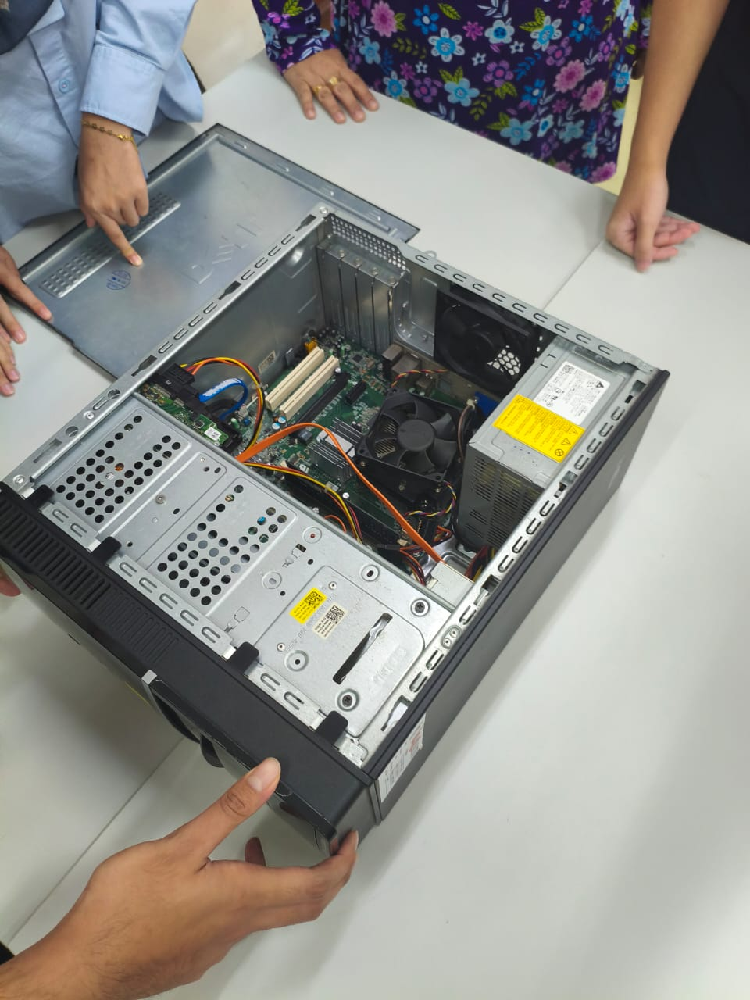

## 2026.11.4

### PC Disassembly and Assembly Course ###
**Learning Outcomes**
- Identified some major components in the PC
- Learned basic PC component disassembly and assembly methods

**Images**

